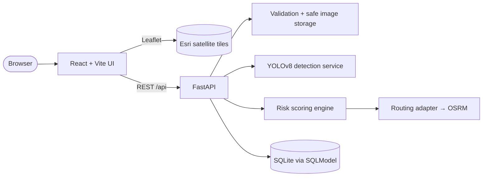

<div align="center">

# 🛡️ RoadGuardian

### AI-Powered Road Risk Intelligence

*Report hazards · AI detection · Community verification · Live satellite map · Route risk comparison*


**Team X_Coder** &nbsp;·&nbsp; Theme: **Road Safety**

[**Quick start**](#2-get-the-code) &nbsp;•&nbsp; [**Demo walkthrough**](#7-using-the-app-demo-walkthrough) &nbsp;•&nbsp; [**How it works**](#9-how-it-is-implemented) &nbsp;•&nbsp; [**API**](#10-api-reference) &nbsp;•&nbsp; [**Troubleshooting**](#13-troubleshooting)

</div>

**Repository:** <https://github.com/manikantad24-web/Road-Safety>

Report road hazards with a photo, get a **real YOLOv8 road-damage detection**, let the community **verify** it, see it on a **live satellite map**, and **compare routes** by a transparent, documented risk score. Authorities get a review queue with status tracking. This README explains how to **install, configure, run, test and deploy** the project.

| 🤖 Real AI, human in the loop | 🗺️ Live hazard map | 🧮 Transparent risk score |
|---|---|---|
| YOLOv8 road-damage model returns classes, boxes and confidence. Users review and can override. | Satellite basemap, markers by severity and status, filters, detail popups. | `severity × recency × verification × proximity`, configurable and documented. |

**Stack:** React + Vite + Tailwind + Leaflet (Esri satellite) + Recharts · FastAPI · SQLite/SQLModel · Ultralytics YOLOv8 · OSRM (replaceable adapter)

> [!IMPORTANT]
> Risk scores are **estimates from user-reported data**. They are not accident statistics or live conditions, and never a guarantee that a route is safe. The admin area uses a shared token: a **local demo**, not production authorization.

## 📑 Contents

| | | |
|---|---|---|
| [1. What you need](#1-what-you-need) | [6. Check it works](#6-check-that-everything-works) | [11. Configuration](#11-configuration-reference) |
| [2. Get the code](#2-get-the-code) | [7. Demo walkthrough](#7-using-the-app-demo-walkthrough) | [12. Deployment](#12-deployment) |
| [3. Backend setup](#3-backend-setup) | [8. Run the tests](#8-run-the-tests) | [13. Troubleshooting](#13-troubleshooting) |
| [4. Frontend setup](#4-frontend-setup) | [9. How it is implemented](#9-how-it-is-implemented) | [14. Verification and limits](#14-verification-status-and-limitations) |
| [5. AI model (optional)](#5-enable-the-ai-model-optional) | [10. API reference](#10-api-reference) | |

---

## 1. What you need

| Requirement | Version | Notes |
|---|---|---|
| Python | 3.11+ (tested on 3.13) | |
| Node.js + npm | 18+ (tested on Node 22) | |
| Internet | — | Needed for the Esri satellite map tiles and the OSRM routing service |
| Disk / RAM | ~2 GB extra | **Only** for the optional AI step (PyTorch) |

The app runs **without** the AI weights (manual-report mode) and **without** routing (a clear "routing unavailable" message). Nothing is faked when a piece is missing.

## 2. Get the code

```powershell
git clone https://github.com/manikantad24-web/Road-Safety.git
cd Road-Safety
```

Layout: `backend/` (FastAPI), `frontend/` (React), `docs/`, `.env.example`.

## 3. Backend setup

Open **PowerShell** in the project folder:

```powershell
cd backend
python -m venv .venv
.\.venv\Scripts\Activate.ps1
```
> [!TIP]
> If activation is blocked ("running scripts is disabled"), run once: `Set-ExecutionPolicy -Scope CurrentUser RemoteSigned`, then activate again.

```powershell
pip install -r requirements-dev.txt      # API + test tools (no PyTorch)
Copy-Item ..\.env.example .env           # create your local config
```

**Edit `backend\.env`** and set a long random admin token:
```
ADMIN_TOKEN=put-a-long-random-string-here
```

Create the database and load **fictional demo data** (18 reports around central Pune; all flagged `is_demo`):
```powershell
python -m scripts.seed
```
Start the API **from the `backend` folder** (the `.env` file is read from the current directory):
```powershell
uvicorn app.main:app --port 8000
```
The SQLite file is created at `backend/data/roadguardian.db` and persists across restarts. Interactive docs: <http://localhost:8000/docs>.

Seed options: `python -m scripts.seed --clear` removes only demo rows; `--reset` re-seeds; `--center <lat> <lng>` moves the sample area.

> [!TIP]
> macOS / Linux: `source .venv/bin/activate` and `cp ../.env.example .env`.

## 4. Frontend setup

In a **second** terminal:

```powershell
cd frontend
npm install
npm run dev
```
Open <http://localhost:5173>. In development, Vite proxies `/api` to `http://127.0.0.1:8000`, so no CORS setup is needed. (Different API address? `$env:VITE_DEV_API_TARGET="http://host:port"` before `npm run dev`.)

## 5. Enable the AI model (optional)

Without weights the sidebar shows an **AI unavailable** state and reports are manual. To turn on real detection:

```powershell
# in backend\ with the venv active
pip install -r requirements-ai.txt       # adds ultralytics + PyTorch (large)
```
Create the folder if it is missing (`New-Item -ItemType Directory -Force models_weights`), then place Ultralytics-format road-damage weights at **`backend\models_weights\road_damage.pt`** (or set `YOLO_WEIGHTS_PATH` in `.env`), then **restart the API**.

We tested with `YOLOv8_Small_RDD.pt` from the public repo `github.com/oracl4/RoadDamageDetection` (YOLOv8-small trained on RDD2022; classes: Longitudinal Crack, Transverse Crack, Alligator Crack, Potholes). **Check the model's and dataset's licences before use beyond a demo.** Weights are git-ignored and not bundled. Different class names? Set `DETECTION_CLASS_MAP` (JSON) in `.env`, e.g. `{"D40":"pothole","D00":"crack"}`.

Confirm: `GET /api/health` shows `"ai": {"available": true, ...}`.

> [!NOTE]
> Image detection cannot establish real-world severity with certainty. Users review every suggestion and can override the type and severity. We make no accuracy claims.

## 6. Check that everything works

With the backend running:
```powershell
Invoke-RestMethod http://localhost:8000/api/health
Invoke-RestMethod "http://localhost:8000/api/hazards?page_size=2"
```
Expected: `status: ok`, `database: ok`, and 18 seeded hazards (`total: 18`). `ai.available` is `true` only after step 5.

## 7. Using the app (demo walkthrough)

| Step | Page | What to do |
|---|---|---|
| 1 | **Dashboard** `/` | See counts, charts, recent activity, map preview. Toggle *Fictional demo data* in the sidebar to separate seeded from real reports. |
| 2 | **Report a hazard** `/report` | Upload a road photo → *Run AI detection* → review classes/confidence → correct type/severity if needed → click the map or enter coordinates → add a description → submit. |
| 3 | **Live hazard map** `/map` | Satellite map; markers differ by severity/status; filter by type and date; open a popup. |
| 4 | **Report details** `/reports/:id` | Image, detections, timeline, verification counts. |
| 5 | **Community verification** `/verify` | Confirm or flag a report. Voting twice from the same client is rejected (409). Reports auto-verify after `VERIFY_THRESHOLD` confirmations (default 3). |
| 6 | **Route safety** `/routes` | Pick origin and destination → candidate routes from OSRM → hazards within `RISK_BUFFER_M` of each route → risk score, distance, hazard count. A lower-risk route is recommended only if it is within `ROUTE_DETOUR_THRESHOLD_PERCENT` (default 20%) of the shortest; otherwise only the shortest is shown, with an explanation. |
| 7 | **Authority dashboard** `/admin` | Enter your `ADMIN_TOKEN` → review the queue → change status (with a note). Each change is saved to the report's history. |

## 8. Run the tests

**Backend** (28 tests: report creation, retrieval, filters, status updates, invalid input, verification de-duplication, upload rejection, risk and routing logic):
```powershell
cd backend
pytest -q
```
Tests use a temporary database and force the AI-unavailable state, so they need no weights or internet.

**Frontend smoke tests** (7 tests, rendered against a *real* running API). They expect a **separate throwaway backend on port 8001**:
```powershell
# terminal A (backend folder, venv active) – use a temp DB so your data is untouched
$env:DATABASE_URL="sqlite:///./data/smoke.db"; $env:ADMIN_TOKEN="smoke-test-token"
python -m scripts.seed
uvicorn app.main:app --port 8001

# terminal B
cd frontend
npm test
```
(`SMOKE_API_URL` overrides the address.) These do not check visual layout. A warning about chart width/height is normal in the headless test environment.

## 9. How it is implemented



```
backend/app/
  main.py           app factory, CORS, error handlers
  config.py         all settings from environment variables
  database.py       engine + init (tables auto-created on startup)
  models/           Hazard, HazardEvent, Verification, Upload (SQLModel)
  schemas/          request/response validation + error format
  api/              hazards.py  detect.py  routes.py  health.py  deps.py
  services/
    detection.py    YOLO wrapper; never fabricates detections
    storage.py      safe image intake (see below)
    risk.py         documented risk formula
    routing.py      RoutingProvider adapter (OSRM implementation)
backend/scripts/seed.py   fictional demo data
backend/tests/            pytest suite
frontend/src/
  pages/            Dashboard ReportHazard LiveMap RouteSafety HazardDetails Verify Admin
  components/       HazardMap, Layout, shared UI, DetectionImage
  lib/api.js        the only place the UI calls the backend
```

**Report flow.** `POST /api/detect` validates and stores the image, runs YOLO, and saves the detections server-side under an `upload_id`. `POST /api/hazards` references that `upload_id`; the server attaches the stored detections itself, so a client cannot forge AI results. `ai_overridden` records whether the user changed the AI's suggestion.

**Safe image storage** (`services/storage.py`): JPEG/PNG/WebP only; size limit enforced while reading (default 8 MB); decompression-bomb limit; the image is **decoded and re-encoded**, which strips EXIF/GPS; random UUID filenames; no filesystem paths are ever returned. Upload validation deliberately uses Pillow's original opener and Ultralytics auto-install is disabled, so an uploaded file cannot trigger a package install (covered by a regression test).

**Verification.** One vote per client per report (`409` on repeat); confirmations beyond the threshold auto-verify; flags are counted and surfaced for review.

**Status updates.** `PATCH /api/hazards/{id}/status` needs the `X-Admin-Token` header (constant-time compare). If `ADMIN_TOKEN` is empty, status updates are disabled.

**Route risk** (`services/risk.py`). For every active report within `RISK_BUFFER_M` (default 60 m) of a route:
```
contribution = severity_weight × recency × verification × proximity
  severity_weight   low 1.0 · medium 2.5 · high 5.0
  recency           halves every 30 days (floored)
  verification      rises with confirmations, falls with flags (clamped)
  proximity         1.0 on the route → lower toward the buffer edge
risk_raw   = Σ contributions
risk_score = 100 × (1 − exp(−risk_raw / RISK_SATURATION_SCALE))     # 0–100
levels     low <25 · moderate <50 · elevated <75 · high
```
Limits: unreported hazards are invisible; report density follows where people report; severity is self-reported; weights are judgement-based defaults, not calibrated against crash data.

**Swapping routing providers.** Implement `RoutingProvider.get_routes(origin, destination)` in `services/routing.py`, register it in `get_provider`, and set `ROUTING_PROVIDER`. If the provider is unreachable the API returns `503 routing_unavailable`; no fallback geometry is ever invented.

## 10. API reference

Interactive docs at `/docs`. Errors: `{"error": {"code", "message", "details?"}}`.

| Method | Path | Notes |
|---|---|---|
| GET | `/api/health` | DB status, AI availability + reason, routing provider |
| GET | `/api/hazards` | filters: type, severity, status, date range, `source=all\|demo\|real`; pagination |
| POST | `/api/hazards` | validated; optional `upload_id` from `/api/detect` |
| GET | `/api/hazards/{id}` | detail + event history |
| PATCH | `/api/hazards/{id}/status` | requires `X-Admin-Token` |
| POST | `/api/hazards/{id}/verify` | `{"vote": "confirm" \| "flag", "note"?}` |
| POST | `/api/detect` | multipart `file` (JPEG/PNG/WebP) |
| POST | `/api/routes/compare` | `{"origin":{"lat","lng"},"destination":{"lat","lng"}}` |
| GET | `/api/stats` | dashboard / admin analytics |

Example:
```powershell
Invoke-RestMethod -Method Post http://localhost:8000/api/routes/compare -ContentType application/json `
  -Body '{"origin":{"lat":18.5204,"lng":73.8567},"destination":{"lat":18.5310,"lng":73.8800}}'
```

## 11. Configuration reference

<details>
<summary><b>Configuration reference (click to expand)</b></summary>


Copy `.env.example` to `backend/.env`. The frontend reads none of these and contains no secrets.

| Variable | Default | Purpose |
|---|---|---|
| `DATABASE_URL` | `sqlite:///./data/roadguardian.db` | Database (use Postgres for multi-instance) |
| `UPLOAD_DIR` | `./uploads` | Stored images |
| `MAX_UPLOAD_MB` | `8` | Upload limit |
| `ALLOWED_ORIGINS` | `http://localhost:5173,…` | CORS origins |
| `ADMIN_TOKEN` | *(set it)* | Demo admin secret; empty disables status updates |
| `VERIFY_THRESHOLD` | `3` | Confirmations to auto-verify |
| `YOLO_WEIGHTS_PATH` | `./models_weights/road_damage.pt` | Model weights |
| `YOLO_CONF` / `YOLO_IOU` / `YOLO_IMGSZ` | `0.25` / `0.45` / `640` | Inference settings |
| `DETECTION_CLASS_MAP` | built-in | JSON: model class → hazard type |
| `ROUTING_PROVIDER` / `OSRM_BASE_URL` | `osrm` / public demo server | Routing (demo server is for light use only) |
| `ROUTING_MAX_ALTERNATIVES` | `3` | Candidate routes requested |
| `ROUTE_DETOUR_THRESHOLD_PERCENT` | `20` | Max extra distance for a safety-based recommendation |
| `RISK_BUFFER_M` | `60` | Distance from route to count a hazard |
| `RISK_WEIGHT_LOW/MEDIUM/HIGH` | `1.0 / 2.5 / 5.0` | Severity weights |
| `RISK_RECENCY_HALF_LIFE_DAYS` | `30` | Recency decay |
| `RISK_SATURATION_SCALE` | `10` | Score scaling |
| `SEED_CENTER_LAT/LNG` | Pune | Demo-data area |
| `VITE_API_BASE_URL` (frontend) | empty | Public API origin for production builds |

</details>

## 12. Deployment

1. **API:** on a server, `pip install -r requirements.txt` (plus `requirements-ai.txt` for detection), set environment variables (long random `ADMIN_TOKEN`, `ALLOWED_ORIGINS` = your site origin), then run `uvicorn app.main:app --host 0.0.0.0 --port 8000` behind HTTPS (e.g. a reverse proxy). Persist `backend/data` and `backend/uploads`.
2. **Frontend:** `cd frontend; npm run build`, then host `frontend/dist` on any static host. Either proxy `/api` to the API on the same origin, or build with `VITE_API_BASE_URL=https://api.example.com`. (The API does **not** serve the built frontend itself.)
3. **Routing:** self-host OSRM or use a commercial provider; the public demo server is for light use only.
4. **Database:** switch `DATABASE_URL` to Postgres for more than one instance.
5. **Before going public:** replace the shared admin token with real authentication.

## 13. Troubleshooting

<details>
<summary><b>Troubleshooting table (click to expand)</b></summary>


| Symptom | Fix |
|---|---|
| `Activate.ps1 cannot be loaded` | `Set-ExecutionPolicy -Scope CurrentUser RemoteSigned` |
| `.env` changes ignored | Start `uvicorn` **from the `backend` folder** (settings load `./.env`) |
| Sidebar says *AI unavailable* | Weights missing/wrong path, or `pip install -r requirements-ai.txt` not run. `GET /api/health` shows the exact reason. Restart the API after adding weights. |
| Model detects wrong class names | Set `DETECTION_CLASS_MAP` |
| Route page: *routing unavailable* (503) | The OSRM server is unreachable (no internet, firewall, or demo server busy). Set `OSRM_BASE_URL` to another server. |
| Blank map background | Satellite tiles need internet access to `server.arcgisonline.com` |
| Status change returns 401 | Wrong/missing admin token; use the exact `ADMIN_TOKEN` from `backend/.env` on the Authority page |
| Browser CORS error in production | Add your site origin to `ALLOWED_ORIGINS` |
| Port already in use | Use `--port 8010` and set `$env:VITE_DEV_API_TARGET="http://127.0.0.1:8010"` for the frontend |
| `npm test` times out | Start the throwaway backend on port 8001 first (section 8) |

</details>

## 14. Verification status and limitations

**Verified (on this code, in a Linux build environment):** 28 backend tests pass · 7 frontend smoke tests pass against a live API · production build succeeds · real YOLO inference returned classes, boxes and confidences on a road image · invalid, oversized and wrong-type uploads are rejected cleanly · a created report survived a server restart · route comparison works end to end against a **local stand-in** serving OSRM-format JSON · Chromium screenshots at 1440 px and 390 px.

**Not verified:** the real public OSRM service and Esri tile servers were unreachable from the build environment, so live routing and the satellite basemap were not exercised there. The PowerShell commands above are the standard equivalents of the Linux commands we ran, but were not run on Windows. We did **not** measure the AI model's accuracy.

**Known limitations:** the admin token is a local demo, not real authentication · vote de-duplication is best-effort per client · risk scores are uncalibrated estimates from reported data · SQLite is single-node · satellite imagery is subject to Esri's terms.

**Credits:** OSRM · Esri World Imagery · Ultralytics YOLO · RDD2022 and the public `oracl4/RoadDamageDetection` model (check licences) · Leaflet · React · FastAPI.

---
**Team X_Coder** · Road Safety · *RoadGuardian reports and estimates; it does not guarantee that any route is safe.*
